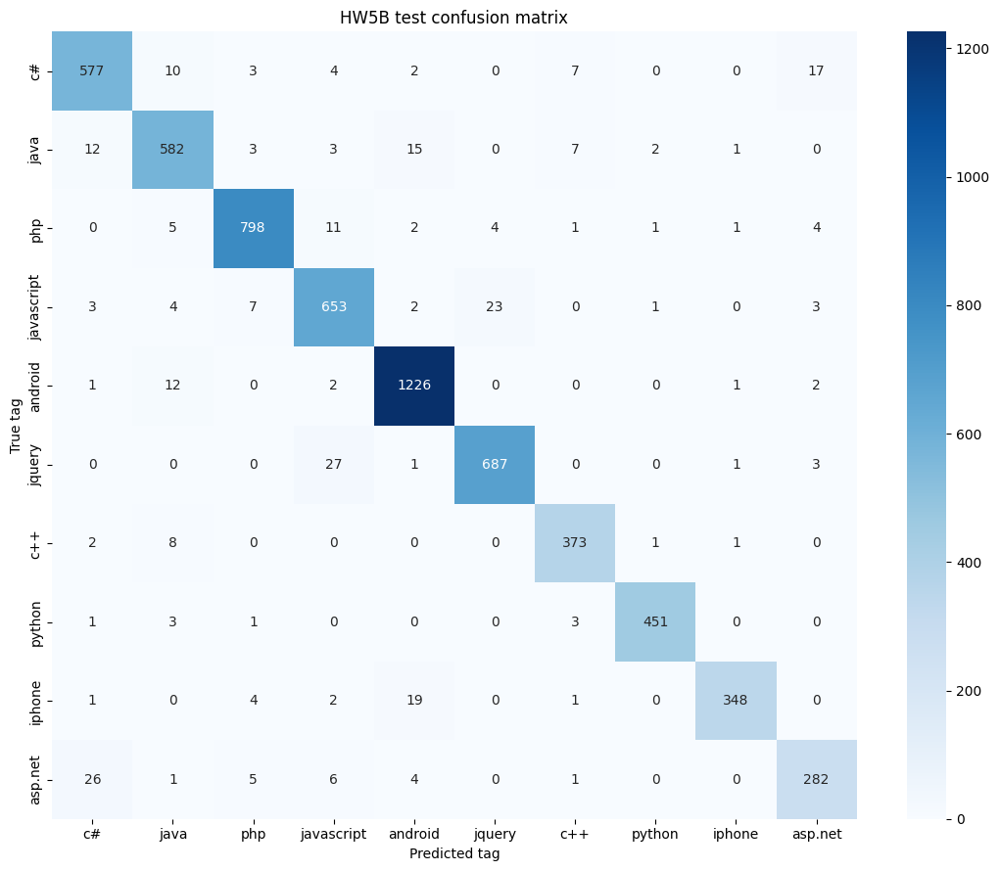
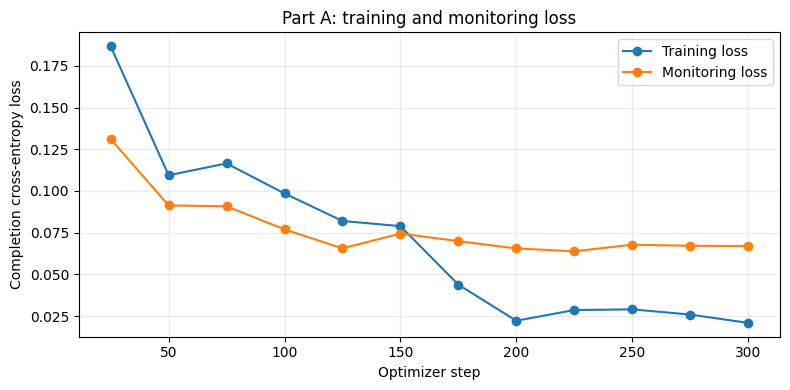
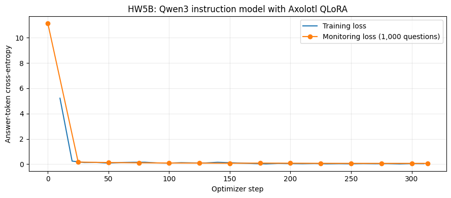

# Generative Tagging with Qwen3: Base vs. Instruction Model, TRL vs. Axolotl

Can an LLM classify text by simply **writing the label**, instead of using a classification head? And does it matter whether you start from a base model or an instruction-tuned chat model?

This is part 2 of my Stack Exchange tagging project. In [part 1](https://github.com/rajatsxngh/modernbert-vs-qwen3-qlora) I fine-tuned ModernBERT and Qwen3 with a **classification head** (the model outputs ten scores and the largest one wins). Here, Qwen3 keeps its **language-model head** and answers with the tag name as text, the way a chat model answers a question. The answer is constrained to the ten valid tags with **vLLM structured outputs**.

| Model | Approach | Training questions | Trainable params | Training time | Peak GPU memory | Val macro-F1 | Test macro-F1 |
|---|---|---|---|---|---|---|---|
| ModernBERT-base ([part 1](https://github.com/rajatsxngh/modernbert-vs-qwen3-qlora)) | Classification head, full fine-tuning | 29,287 | 149.6M | 8.2 min (A100) | 7.05 GB | 0.933 | 0.922 |
| Qwen3-1.7B-Base ([part 1](https://github.com/rajatsxngh/modernbert-vs-qwen3-qlora)) | Classification head, QLoRA | 5,000 | 139.5M | 17.6 min (A100) | 4.66 GB | 0.946 | 0.941 |
| **Qwen3-1.7B-Base** (Part A) | **Writes the tag**, QLoRA with TRL | 5,000 | 139.5M | 40.6 min (L4) | 11.14 GiB | 0.949 | **0.950** |
| **Qwen3-1.7B** instruction model (Part B) | **Writes the tag in a chat**, QLoRA with Axolotl | 5,000 | 139.5M | 39.5 min (L4) | 11.05 GiB | 0.949 | 0.948 |

## Key findings

- **Writing the label beat the classification head.** With the same base model and the same 5,000 training questions, generating the tag as text reached 0.950 test macro-F1, vs. 0.941 for the classification head (+0.9 points).
- **Base and instruction models end up in the same place.** After fine-tuning, both score about 0.95 (0.950 vs. 0.948). With one run each, that gap is within run-to-run noise.
- **But they start very differently.** Before any training, the base model just continues the `### LABEL:` pattern and usually writes a tag: 0.745 validation macro-F1 with the constraint, and only 166 of 1,000 free answers were not a tag. The instruction model answers like a chatbot (*"The text is discussing **JavaScript**…"*): 994 of 1,000 free answers were not a tag, and forcing it to start with a tag gave only 0.161 macro-F1.
- **Fine-tuning fixes the format completely.** After training, both models gave a valid tag on **1,000 of 1,000** free (unconstrained) answers. Constrained decoding is essential for an untrained model, and a safety net for a fine-tuned one.
- **One space character matters.** The completion is `" javascript"`, not `"javascript"`: with the leading space it is a single different token (ID 35710 vs. 14073). Prompts and constrained choices at inference must match training exactly, down to that space.
- **The same tag pairs stay hard:** c# ↔ asp.net, javascript ↔ jquery, javascript ↔ php and iphone ↔ android. They share code and topics (ASP.NET apps are written in C#; jQuery *is* JavaScript).

## Data

The same 41,838 Stack Exchange questions as part 1 (title + body, raw HTML and code kept), one of ten tags each.

| Split | Questions | Used for |
|---|---|---|
| train subset | 5,000 | Training both models (same subset as the part-1 Qwen3 model) |
| validation subset | 1,000 | Monitoring training loss and picking the best checkpoint; free-answer experiment |
| validation | 6,276 | Final validation score |
| test | 6,275 | One final evaluation per model |

The dataset file is not included. See [`data/README.md`](data/README.md) for the expected format.

## Approach

**Part A · Base model with TRL** ([training](notebooks/01_base_trl_training.ipynb) · [evaluation](notebooks/02_base_vllm_inference.ipynb))
- `Qwen/Qwen3-1.7B-Base` in 4-bit NF4, LoRA r=128, α=256 on all attention and MLP projections.
- Prompt/completion pairs: `Classify the TEXT by selecting one label from the following list: [...]. ### TEXT: {question} ### LABEL:` → `" javascript"`.
- TRL `SFTTrainer` with `completion_only_loss=True`, so only the tag and the end-of-sequence token count toward the loss (the notebook prints the exact supervised tokens).

**Part B · Instruction model with Axolotl** ([training](notebooks/03_instruct_axolotl_training.ipynb) · [evaluation](notebooks/04_instruct_vllm_inference.ipynb))
- `Qwen/Qwen3-1.7B` (instruction model), QLoRA with the same LoRA settings, configured in an Axolotl YAML.
- Chats written to JSON Lines: the user asks for the tag, the assistant answers with just the tag.
- `train_on_inputs: false`; `axolotl preprocess --debug` shows that only the tag and `<|im_end|>` carry labels, while the question and the empty `<think>` block are masked.

**Shared setup**
- 2 epochs, effective batch 32 (8 × 4 accumulation), lr 1e-4, gradient checkpointing, bf16, seed 42; evaluation and checkpoints every 25 steps, **best checkpoint chosen by validation loss**.
- Adapters pushed to the Hugging Face Hub and loaded in **vLLM** in a separate notebook (vLLM and the training libraries need different package versions).
- Greedy decoding with `StructuredOutputsParams(choice=...)`, so every answer is exactly one of the ten tags.
- Two extra experiments per model: the untrained model with the constraint, and untrained vs. fine-tuned without the constraint (counting answers that are not a tag).
- All runs logged to **Weights & Biases**: [public project](https://forge.coreweave.com/wandb/rajat-utd/hw5_decoder_tags).


## Trained models

Both LoRA adapters are on the Hugging Face Hub, with a short example of how to load them:

- **Part A (base model):** [rajatsxngh/qwen3-base-tag-adapter](https://huggingface.co/rajatsxngh/qwen3-base-tag-adapter), adapter for `Qwen/Qwen3-1.7B-Base`
- **Part B (instruction model):** [rajatsxngh/qwen3-instruct-tag-adapter](https://huggingface.co/rajatsxngh/qwen3-instruct-tag-adapter), adapter for `Qwen/Qwen3-1.7B`

## Results

| Part A (base, TRL): test confusion matrix | Part B (instruction, Axolotl): test confusion matrix |
|---|---|
|  |  |

| Part A: training and validation loss | Part B: training and validation loss |
|---|---|
|  |  |

Before vs. after fine-tuning:

| | Base model (Part A) | Instruction model (Part B) |
|---|---|---|
| Untrained, constrained: validation macro-F1 | 0.745 | 0.161 |
| Untrained, free answers that are not a tag (of 1,000) | 166 | 994 |
| Fine-tuned, free answers that are not a tag (of 1,000) | 0 | 0 |
| Fine-tuned, constrained: test macro-F1 | **0.950** | 0.948 |

Per-tag test F1:

| Tag | Classification head (part 1) | Part A: base, writes tag | Part B: instruction, writes tag |
|---|---|---|---|
| python | **0.987** | **0.987** | 0.986 |
| android | 0.971 | **0.976** | 0.975 |
| php | 0.967 | 0.962 | **0.968** |
| c++ | 0.966 | **0.972** | 0.959 |
| jquery | 0.947 | **0.965** | 0.959 |
| iphone | 0.945 | **0.962** | 0.956 |
| java | 0.931 | **0.937** | 0.931 |
| javascript | 0.918 | **0.937** | 0.930 |
| c# | 0.917 | 0.920 | **0.928** |
| asp.net | 0.864 | 0.880 | **0.887** |
| **macro avg** | 0.941 | **0.950** | 0.948 |

All numbers are also in [`results/metrics.json`](results/metrics.json).

## Engineering notes

- **Two environments.** Training (TRL or Axolotl) and inference (vLLM) need different package versions, so each runs in its own fresh Colab session. The adapter, tokenizer and a training summary are pushed to the Hub, and the inference notebook checks that the dataset, tag order and prompt format match training before evaluating.
- **Same prompt, character for character.** Inference rebuilds every prompt with the exact function used in training and sends token IDs directly to vLLM, so the engine cannot add or change tokens.
- **Peak memory with Axolotl.** Axolotl resets PyTorch's peak-memory counter each time it logs, so a single end-of-run reading only covered the last interval (2.3 GiB). The reported 11.05 GiB is the largest value logged during training, which is comparable to Part A's run-wide peak.
- **Tokenizer versions.** The Axolotl environment saves the tokenizer with Transformers 5, which stores special tokens under a different key than the Transformers 4 used by vLLM. The inference notebook translates that one field in a copy and verifies that the vocabulary and token IDs are unchanged.

## Limitations and next steps

- Single run per model with one seed; differences of about half a point are within noise.
- Part 1 ran on an A100 and this part on an L4, so training times are not directly comparable across the two parts.
- Generation is slower than a classification head at inference (about 60–65 questions/second here with vLLM on an L4).
- **Next:** several seeds per setup, the same experiment with fewer training questions (does the instruction model's poor start matter more with less data?), and a larger instruction model.

## Repository structure

```
├── notebooks/
│   ├── 01_base_trl_training.ipynb          # Part A: base model + TRL, all outputs included
│   ├── 02_base_vllm_inference.ipynb        # Part A: vLLM evaluation and experiments
│   ├── 03_instruct_axolotl_training.ipynb  # Part B: instruction model + Axolotl
│   └── 04_instruct_vllm_inference.ipynb    # Part B: evaluation, comparison and discussion
├── results/
│   ├── metrics.json                        # headline, per-tag and experiment numbers
│   └── figures/                            # confusion matrices and loss curves
├── data/README.md                          # dataset format (data not included)
├── requirements-trl.txt                    # Part A training environment
├── requirements-axolotl.txt                # Part B training environment
└── requirements-inference.txt              # vLLM evaluation environment
```

## How to run

1. Open a notebook in Google Colab with an **A100, L4 or RTX PRO 6000 GPU**, in a fresh session for each notebook.
2. In the **Configuration** cell, change `HF_USERNAME`, `HF_REPO_ID` and `WANDB_ENTITY` to your own Hugging Face and W&B accounts (they are set to mine, and the notebook checks that you are signed in to the account in `HF_USERNAME`).
3. Add `HF_TOKEN` (with write access, to push the adapter) and `WANDB_API_KEY` as Colab secrets.
4. The first time you run the data cell, it mounts Google Drive and asks you to upload `multiclass_split.csv` from your computer. It saves the file to Drive (`MyDrive/HW5_Decoder_Tags/`), so the other notebooks find it there.
5. Run the training notebook, then the matching inference notebook in a new session. The first cell of each installs its pinned packages.

## Tech stack

Python · PyTorch · Hugging Face Transformers, TRL, PEFT · Axolotl · bitsandbytes (4-bit NF4) · vLLM (structured outputs) · scikit-learn · Weights & Biases · Google Colab (NVIDIA L4)
